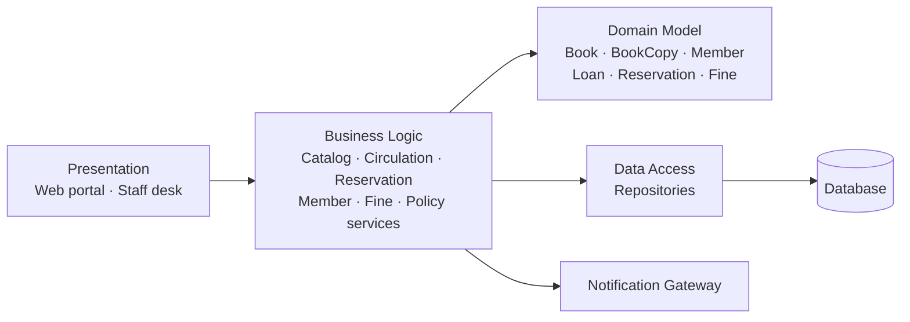
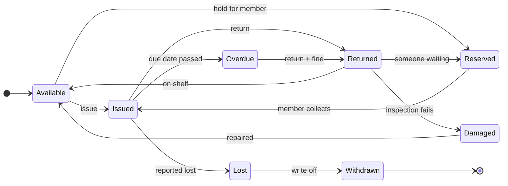

# Library Management System: Object-Oriented Analysis & Design

An **analysis and modeling** project for a simplified Library Management System. It goes from requirements to architecture, from OOA diagrams to data, functional and behavioral models, and finally to code that shows how the design is implemented.

> All diagrams are written in **Mermaid**, so GitHub draws them directly in the browser. No image files are needed, and every diagram can be edited as text.

## Contents

| # | Document | What's inside |
|---|---|---|
| 1 | [Requirement Analysis](docs/01-requirements-analysis.md) | Actors, 18 use cases, detailed use case descriptions, functional and non-functional requirements, business rules |
| 2 | [System Architecture](docs/02-system-architecture.md) | Layered architecture, high-level component diagram, component responsibilities, request flow, deployment view |
| 3 | [Class Diagram (OOA)](docs/03-class-diagram.md) | Noun/verb analysis, CRC cards, domain class diagram, service/repository class diagram |
| 4 | [Use Case Diagrams](docs/04-use-case-diagrams.md) | Whole-system diagram, circulation (`«include»`/`«extend»`), administration |
| 5 | [Sequence Diagrams](docs/05-sequence-diagrams.md) | **Issue Book**, **Return Book**, **Search Book**, **Reserve Book** |
| 6 | [State Diagram: Book](docs/06-state-diagrams.md) | Full lifecycle of a book copy, state and transition tables |
| 7 | [Data Model](docs/07-data-model.md) | ER diagram, class-to-table mapping, data dictionary, constraints, 3NF |
| 8 | [Functional Model](docs/08-functional-model.md) | DFD level 0 / 1 / 2, functional decomposition, input-process-output table |
| 9 | [Behavioral Model](docs/09-behavioral-model.md) | Event-response table, activity diagrams, Loan/Reservation/Member state diagrams, timeline |
| 10 | [Abstraction to Implementation](docs/10-implementation.md) | Traceability matrix, pseudocode, Java code walkthrough, real program output |

## How the brief is covered

| Instruction | Where |
|---|---|
| Identify the main actors | [§1.2 Actors](docs/01-requirements-analysis.md#12-actors): Member (Student/Faculty), Librarian, Administrator, Scheduler, Notification Gateway |
| List the key use cases | [§1.3](docs/01-requirements-analysis.md#13-key-use-cases) (18 use cases) and [§1.4](docs/01-requirements-analysis.md#14-detailed-use-case-descriptions) (full descriptions) |
| Define major system components | [§2.1](docs/02-system-architecture.md#21-architectural-style-layered-n-tier): UI, business logic, domain, data access, database |
| High-level architectural diagram | [§2.2](docs/02-system-architecture.md#22-high-level-architecture-diagram) (+ [deployment §2.5](docs/02-system-architecture.md#25-deployment-view)) |
| Classes with attributes and methods | [§3.1–3.2](docs/03-class-diagram.md#31-finding-the-classes-nounverb-analysis): noun/verb analysis and CRC cards |
| Class diagram | [§3.3](docs/03-class-diagram.md#33-domain-class-diagram), [§3.4](docs/03-class-diagram.md#34-people-and-roles-inheritance) and [§3.5](docs/03-class-diagram.md#35-service-and-data-access-classes) |
| Use case diagrams | [§4](docs/04-use-case-diagrams.md) (3 diagrams) |
| Sequence diagrams (at least 2) | [§5](docs/05-sequence-diagrams.md) (**4** diagrams) |
| State diagram for Book | [§6](docs/06-state-diagrams.md): Available → Reserved → Issued → Overdue → Returned → Damaged / Lost → Withdrawn |
| Data model | [§7](docs/07-data-model.md) + runnable [`sql/schema.sql`](sql/schema.sql) |
| Functional model | [§8](docs/08-functional-model.md) |
| Behavioral model | [§9](docs/09-behavioral-model.md) |
| Pseudocode / code snippets | [§10](docs/10-implementation.md) + compiling Java in [`src/`](src/main/java/com/library) |

## Overview

### Architecture (layered)



### Book (copy) lifecycle



## Repository structure

```
library-system-ooa-design/
├── README.md                     ← you are here
├── docs/                         ← analysis and design documents (with diagrams)
│   ├── 01-requirements-analysis.md
│   ├── 02-system-architecture.md
│   ├── 03-class-diagram.md
│   ├── 04-use-case-diagrams.md
│   ├── 05-sequence-diagrams.md
│   ├── 06-state-diagrams.md
│   ├── 07-data-model.md
│   ├── 08-functional-model.md
│   ├── 09-behavioral-model.md
│   └── 10-implementation.md
├── sql/
│   ├── schema.sql                ← data model as SQL (SQLite / PostgreSQL)
│   └── sample-queries.sql        ← use cases expressed as queries
├── src/main/java/com/library/    ← code that implements the models
│   ├── domain/                   Book, BookCopy, BookStatus, Member, Loan, Reservation, LoanPolicy
│   ├── repository/               LibraryRepository (interface) + in-memory version
│   ├── service/                  CirculationService, Notifier
│   └── ui/                       LibraryDemo (console)
├── run.bat                       ← Windows: compile + run the demo
└── run.sh                        ← macOS / Linux
```

## Run the code example

You need **JDK 17 or newer**.

```bash
run.bat          # Windows
sh run.sh        # macOS / Linux
```

The demo walks through Search → Issue → refused issue → Reserve → overdue check → late Return (fine + hand-off to the reservation) → collect reservation → illegal state transition. The output is in [§10.5](docs/10-implementation.md#105-running-the-example).

To try the data model:

```bash
sqlite3 library.db < sql/schema.sql
sqlite3 library.db < sql/sample-queries.sql
```

## Design principles applied

- **Single Responsibility:** one class per concept (`Loan` handles loans, `Fine` handles money), one service per business area.
- **Encapsulation:** a copy's status can only change through methods that enforce the state diagram.
- **Information Expert:** `Member` decides eligibility, `Loan` calculates fines.
- **Low coupling:** layers only call the layer below; services depend on repository *interfaces*.
- **Open/Closed:** new member types or notification channels plug in without changing existing code.

## Tools

Diagrams were written in [Mermaid](https://mermaid.js.org/), a diagrams-as-code tool. Each one was checked by rendering it with the Mermaid CLI. You can paste any diagram block into the [Mermaid Live Editor](https://mermaid.live) to edit it or export it as PNG or SVG.
