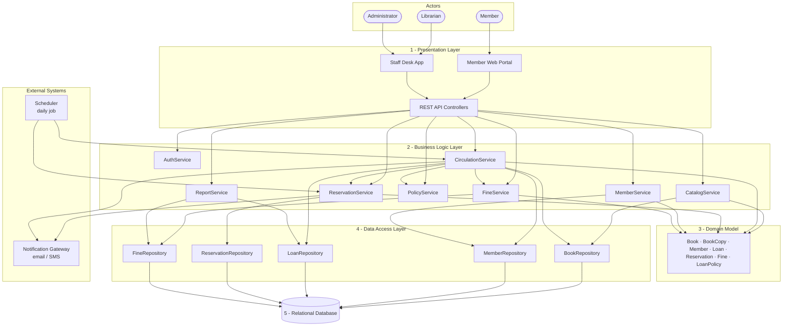
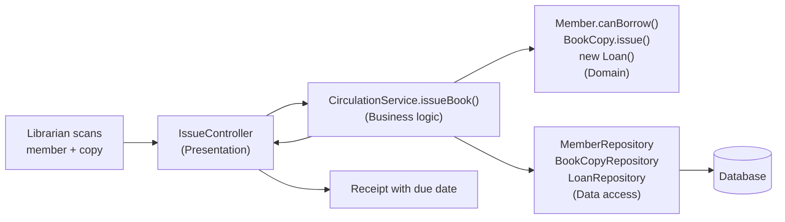
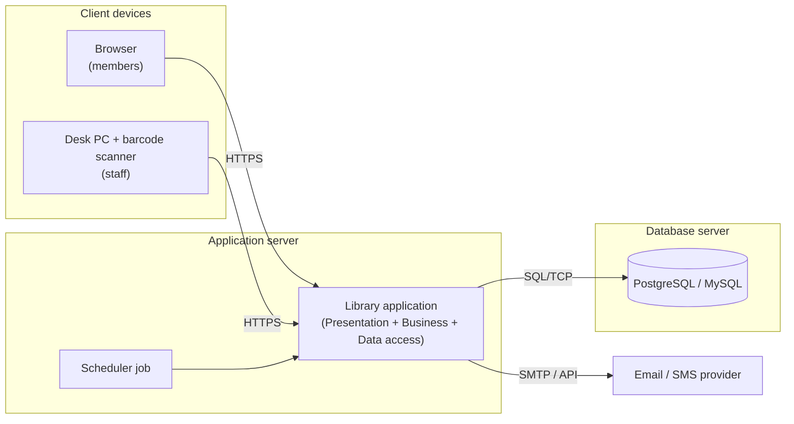

# 2. System Architecture Design

[← Requirements](01-requirements-analysis.md) · [README](../README.md) · Next: [Class Diagram →](03-class-diagram.md)

## 2.1 Architectural style: layered (n-tier)

The system uses a **layered architecture**. Each layer has one responsibility and only talks to the layer directly below it:

| Layer | Responsibility | Main components |
|---|---|---|
| **1. Presentation (UI)** | Show screens, collect input, show results. **No business rules.** | Member Web Portal, Staff Desk App, REST API controllers |
| **2. Business logic (service)** | Apply library rules: eligibility, due dates, fines, reservation queue | `CatalogService`, `CirculationService`, `MemberService`, `ReservationService`, `FineService`, `ReportService`, `AuthService`, `PolicyService` |
| **3. Domain model** | The objects of the problem: what they are and what they can do | `Book`, `BookCopy`, `Member`, `Loan`, `Reservation`, `Fine`, `LoanPolicy` |
| **4. Data access** | Save and load domain objects, hiding SQL from the layers above | `BookRepository`, `MemberRepository`, `LoanRepository`, `ReservationRepository`, `FineRepository`, `StaffRepository` |
| **5. Data storage** | Persistent storage | Relational database (see the [data model](07-data-model.md)) |

**Cross-cutting concerns** used by every layer: authentication and role-based access, audit logging, and configuration.
**External systems:** the Notification Gateway (email/SMS) and the Scheduler (a daily job).

### Why layered?

- **Separation of concerns:** the UI can change (web → mobile) without touching the business rules.
- **Testability:** services can be tested with in-memory repositories instead of a real database.
- **Maintainability:** each rule lives in exactly one place. For example, the fine calculation is only in `FineService` and `Loan`.
- **Replaceability:** the database or the notification provider can be swapped behind an interface.

## 2.2 High-level architecture diagram

## 2.3 Component responsibilities

| Component | Responsibility | Used by use cases |
|---|---|---|
| `AuthService` | Log in and out, password hashing, role checks | UC-16 |
| `CatalogService` | Search titles, view details, add/edit/withdraw books and copies | UC-01, UC-02, UC-12 |
| `CirculationService` | **Issue, return and renew** loans; enforce limits; calculate due dates | UC-03, UC-04, UC-05, UC-17 |
| `ReservationService` | Reservation queue per title; hold copies; expire holds | UC-06, UC-07, UC-18 |
| `MemberService` | Register, update, block and unblock members; account overview | UC-08, UC-10, UC-11 |
| `FineService` | Create fines, record payments, check the unpaid total | UC-04, UC-09 |
| `PolicyService` | Read and update `LoanPolicy` per member type | UC-14 |
| `ReportService` | Read-only statistics | UC-15 |
| Repositories | CRUD for one aggregate each; the only code that talks SQL | all |
| Notification Gateway | Sends messages; called through a `Notifier` interface | UC-04, UC-17 |
| Scheduler | Calls `CirculationService.flagOverdueLoans()` and `ReservationService.expireHolds()` every night | UC-17, UC-18 |

## 2.4 How a request flows through the layers (Issue Book)

The detailed message-by-message version is in the [sequence diagrams](05-sequence-diagrams.md#51-issue-book-uc-03).

## 2.5 Deployment view

## 2.6 Design principles applied

| Principle | How |
|---|---|
| **Single Responsibility** | One service per business area; one repository per aggregate |
| **Encapsulation** | State changes go through methods (`BookCopy.issue(member)`), never by setting fields directly |
| **Dependency Inversion** | Services depend on repository **interfaces**, so the database can be swapped |
| **Low coupling / high cohesion** | The UI never touches repositories, and repositories contain no rules |
| **Open/Closed** | New member types or notification channels are added without editing existing services |
