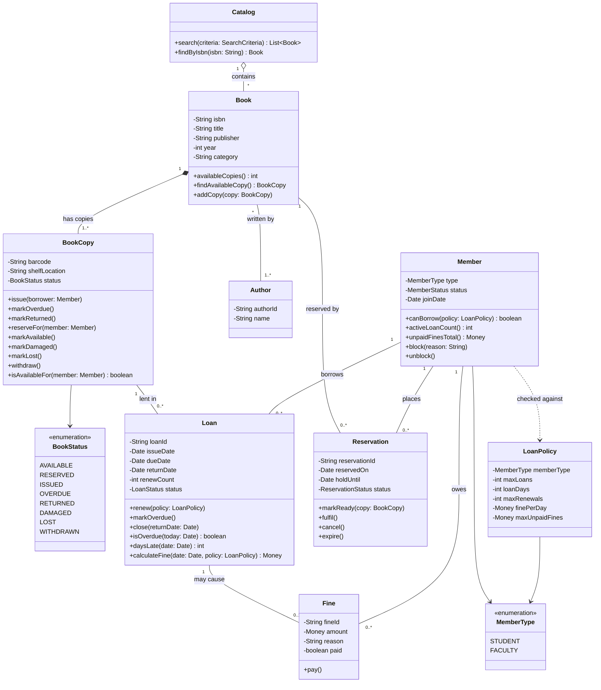
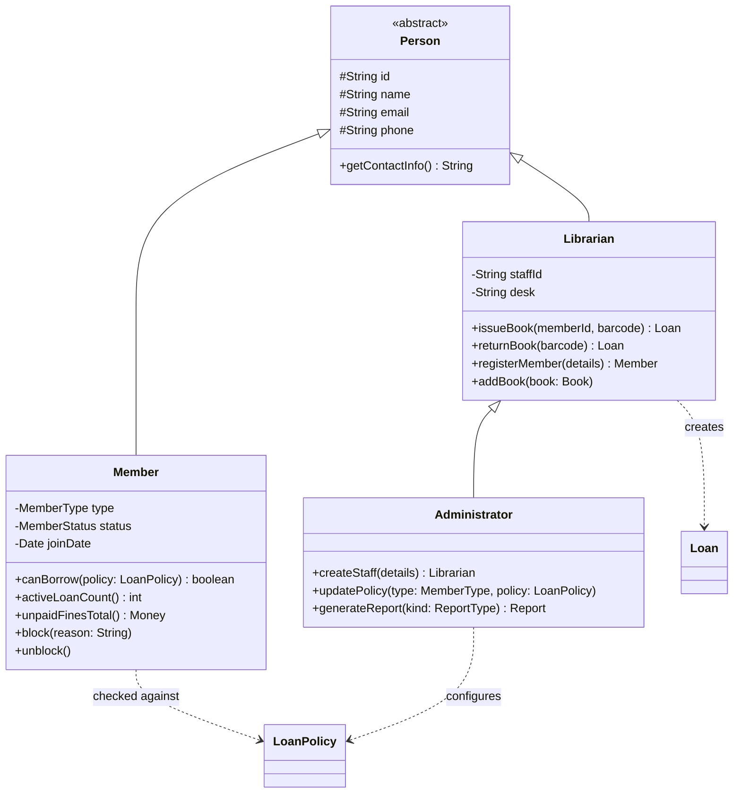
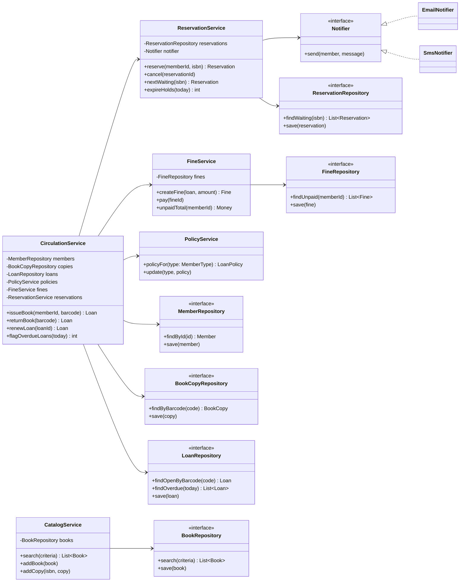

# 3. Object-Oriented Analysis: Classes

[← Architecture](02-system-architecture.md) · [README](../README.md) · Next: [Use Case Diagrams →](04-use-case-diagrams.md)

## 3.1 Finding the classes (noun/verb analysis)

The use case descriptions were read and every **noun** marked as a candidate class or attribute, and every **verb** as a candidate method.

> "The **librarian** scans the **member card**, the system checks the **member** is active and below the **loan limit**, scans the **copy barcode**, creates a **loan** with a **due date**, and the **copy** becomes issued. On a late **return** a **fine** is charged. If a **reservation** is waiting, the next member is notified."

| Candidate noun | Decision | Reason |
|---|---|---|
| Librarian, Administrator, Member | ✅ classes | Actors that also hold data (a staff id, a borrowing history) |
| Person | ✅ abstract class | Shared name, email and phone of members and staff |
| Book | ✅ class | A *title* in the catalogue (ISBN, title, authors) |
| Copy / barcode | ✅ class **BookCopy** | The library owns several physical copies of one title; each has its own status. That status is what the state diagram models. |
| Author | ✅ class | One book can have many authors, and one author many books |
| Loan | ✅ class | An event with its own data: issue date, due date, return date |
| Reservation | ✅ class | A hold, with a queue position and a status |
| Fine | ✅ class | An amount with a paid/unpaid lifecycle |
| Loan limit, loan period, fine rate | ✅ class **LoanPolicy** | Rules that differ by member type and can be changed by the admin |
| Member card | ❌ attribute | Just `Member.memberId` |
| Due date, return date | ❌ attributes | Of `Loan` |
| Catalogue | ✅ class | Searches across all books |
| Receipt, screen | ❌ | Presentation, not domain |

| Verb | Becomes method |
|---|---|
| search | `Catalog.search(criteria)` |
| issue / lend | `CirculationService.issueBook(memberId, barcode)`, `BookCopy.issue(member)` |
| check eligibility | `Member.canBorrow(policy)` |
| return | `CirculationService.returnBook(barcode)`, `Loan.close(date)`, `BookCopy.markReturned()` |
| renew | `Loan.renew(policy)` |
| reserve | `ReservationService.reserve(memberId, isbn)` |
| charge / calculate fine | `Loan.calculateFine(date, policy)` |
| pay | `Fine.pay()` |
| block / unblock | `Member.block()`, `Member.unblock()` |

## 3.2 CRC cards (Class, Responsibilities, Collaborators)

| Class | Responsibilities (what it knows and does) | Collaborators |
|---|---|---|
| **Book** | Knows ISBN, title, authors, category, year. Lists its copies, counts available copies, finds an available copy. | BookCopy, Author |
| **BookCopy** | Knows barcode, shelf location and **status**. Changes status *only* through allowed transitions (issue, return, reserve, mark lost or damaged). | Book, Loan |
| **Member** | Knows member type, status, current loans and unpaid fines. Decides whether it **can borrow** under a policy. | Loan, Fine, LoanPolicy |
| **Loan** | Knows member, copy, issue date, due date and return date. Can **renew**, **close**, tell whether it's **overdue**, and calculate its **fine**. | Member, BookCopy, LoanPolicy |
| **Reservation** | Knows member, book, date and status. Can be marked ready, fulfilled, cancelled or expired. | Member, Book |
| **Fine** | Knows amount, reason and paid status. Can be **paid**. | Member, Loan |
| **LoanPolicy** | Knows the max loans, loan days, max renewals and daily fine for one member type | Member, Loan |
| **Librarian** | Knows staff id. Performs circulation and catalogue tasks through the services. | CirculationService, CatalogService |
| **Administrator** | Everything a Librarian does, plus managing staff and policies | PolicyService, ReportService |

## 3.3 Domain class diagram

The core of the model: the catalogue, copies, loans, reservations, fines and the rules that govern them. `Member` is shown here with its own attributes. Its inheritance from `Person` is in [§3.4](#34-people-and-roles-inheritance).

## 3.4 People and roles (inheritance)

Shown separately so the inheritance hierarchy stays easy to read.

### Reading the relationships

| Relationship | Kind | Meaning |
|---|---|---|
| `Person <|-- Member / Librarian` | **Inheritance** | Shared identity and contact data |
| `Librarian <|-- Administrator` | **Inheritance** | Admin can do everything a librarian can, and more |
| `Book *-- BookCopy` | **Composition** | A copy can't exist without its title. Deleting the title deletes its copies. |
| `Catalog o-- Book` | **Aggregation** | The catalogue groups books, but a book has its own identity |
| `Book -- Author` (many-to-many) | **Association** | Resolved by a `BOOK_AUTHOR` table in the [data model](07-data-model.md) |
| `Member 1 -- 0..* Loan` | **Association with multiplicity** | A member has zero or more loans; each loan belongs to one member |
| `Loan 1 -- 0..1 Fine` | **Association** | A loan causes at most one late fine |
| `Member ..> LoanPolicy` | **Dependency** | `canBorrow()` *uses* a policy but doesn't own it |
| `Librarian ..> Loan`, `Administrator ..> LoanPolicy` | **Dependency** | Staff create loans and configure policies through the services |

## 3.5 Service and data-access classes

The architecture layers from [section 2](02-system-architecture.md) as classes. Services depend on repository **interfaces**, which is Dependency Inversion.

