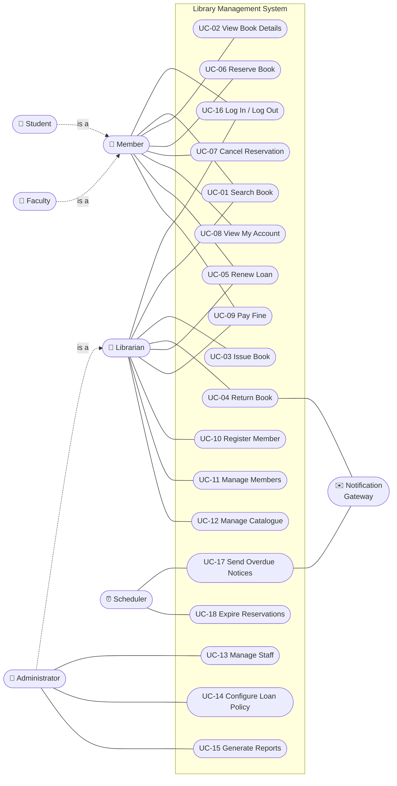
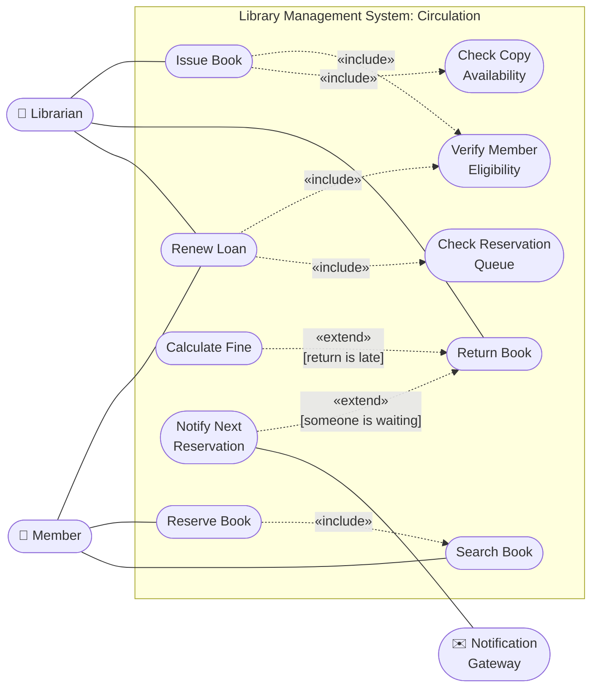
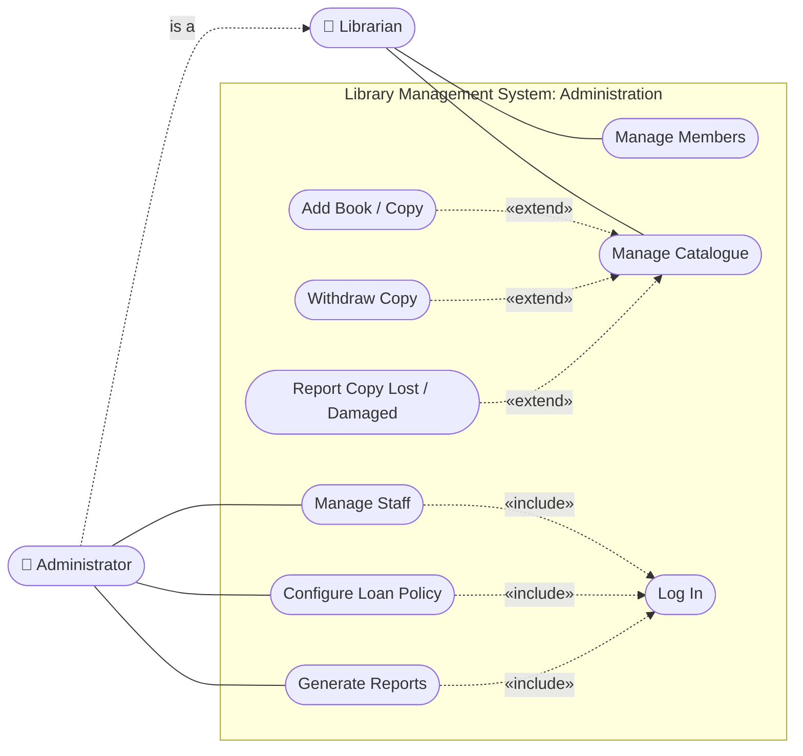

# 4. Use Case Diagrams

[← Class Diagram](03-class-diagram.md) · [README](../README.md) · Next: [Sequence Diagrams →](05-sequence-diagrams.md)

> **Notation.** Mermaid has no native UML use case diagram, so these follow UML conventions with a flowchart:
> **actors** are the figures outside the box, **use cases** are the rounded ovals inside the **system boundary**,
> solid lines are **associations** and dotted arrows are `«include»` / `«extend»` relationships.
> The use case IDs match the [requirements](01-requirements-analysis.md#13-key-use-cases).

## 4.1 Overall system use case diagram

**Reading it:** a *Student* or *Faculty* is a kind of *Member* (actor generalisation), so they inherit every member use case. The *Administrator* is a kind of *Librarian*, so it gets all librarian use cases plus three of its own. The *Scheduler* and *Notification Gateway* are non-human secondary actors.

## 4.2 Circulation use cases in detail (`«include»` and `«extend»`)

| Relationship | Meaning here |
|---|---|
| `Issue Book «include» Verify Member Eligibility` | **Always** happens: every issue checks the member is active, under the limit and not owing too much |
| `Issue Book «include» Check Copy Availability` | **Always** happens: the copy must be `AVAILABLE`, or `RESERVED` for this member |
| `Calculate Fine «extend» Return Book` | **Only sometimes**, when the return date is after the due date (extension point *after recording return*) |
| `Notify Next Reservation «extend» Return Book` | **Only sometimes**, when the title has a waiting reservation |
| `Reserve Book «include» Search Book` | The member must find the title first |

> Note the arrow direction: `«include»` points **from** the base use case **to** the included one, while `«extend»` points **from** the extension **to** the base use case. That's the standard UML convention.

## 4.3 Administration use cases

