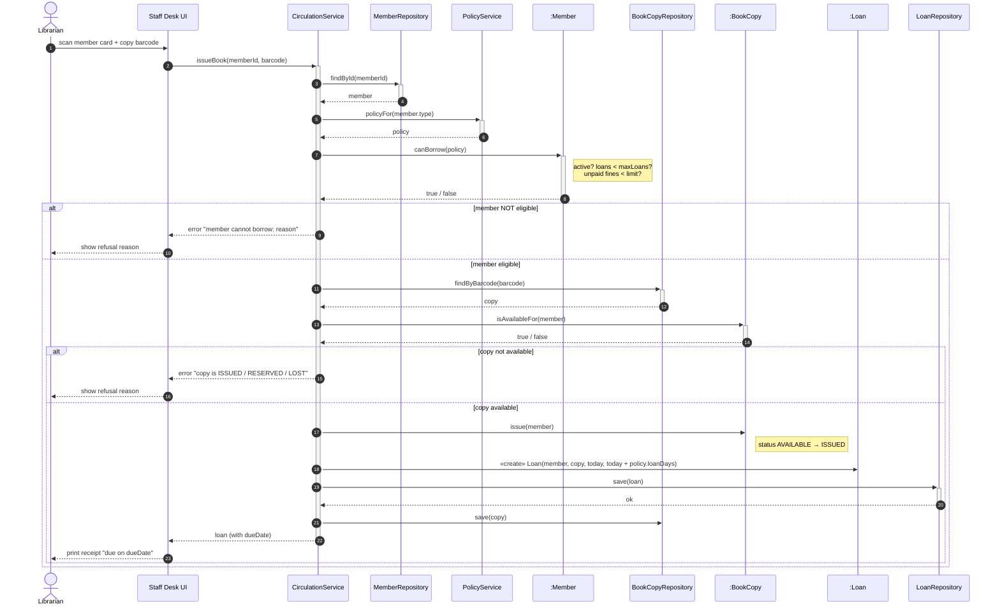
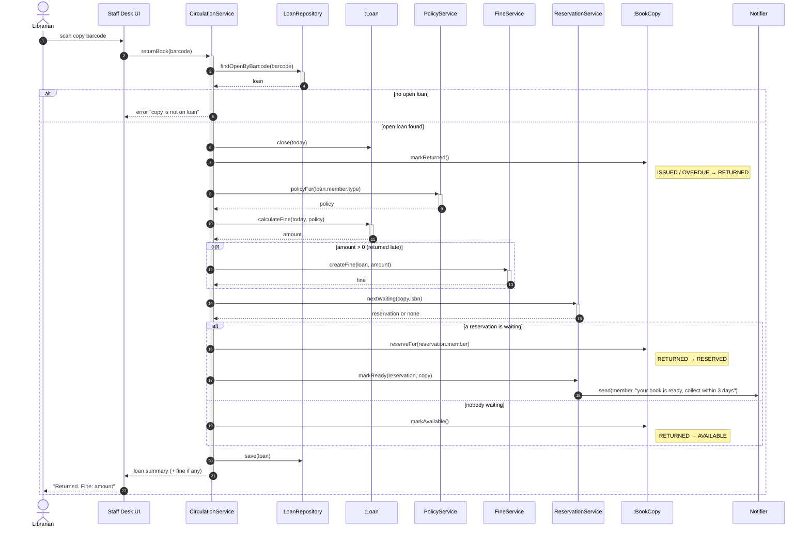
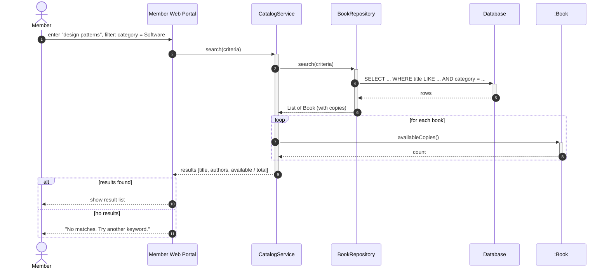
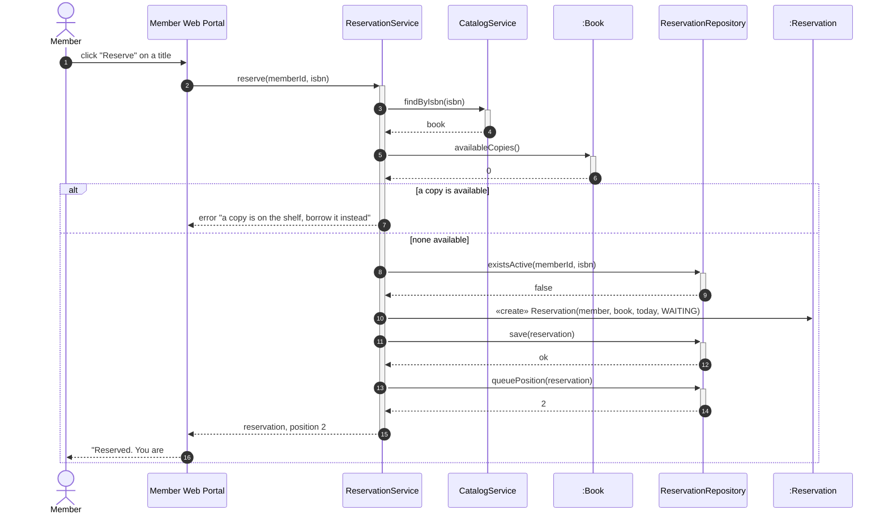

# 5. Sequence Diagrams

[← Use Case Diagrams](04-use-case-diagrams.md) · [README](../README.md) · Next: [State Diagrams →](06-state-diagrams.md)

Sequence diagrams show **which objects talk to each other, in what order**, to carry out one use case. Each one follows the [layers](02-system-architecture.md): UI → Service → Domain objects / Repositories → Database.

Notation: solid arrows `->>` are calls, dashed arrows `-->>` are returns, `alt` boxes are if/else, and `opt` boxes are optional steps.

## 5.1 Issue Book (UC-03)

**Key design points**
- The **eligibility rule** lives in `Member.canBorrow()` (the information expert), not in the UI.
- The **status change** happens inside `BookCopy.issue()`, which refuses illegal transitions (see the [state diagram](06-state-diagrams.md)).
- Steps 17–21 (change the copy's status, create the loan and save both) run in **one database transaction**, so a copy can never be issued twice.

## 5.2 Return Book (UC-04), with fine and reservation hand-off

## 5.3 Search Book (UC-01)

## 5.4 Reserve Book (UC-06)

