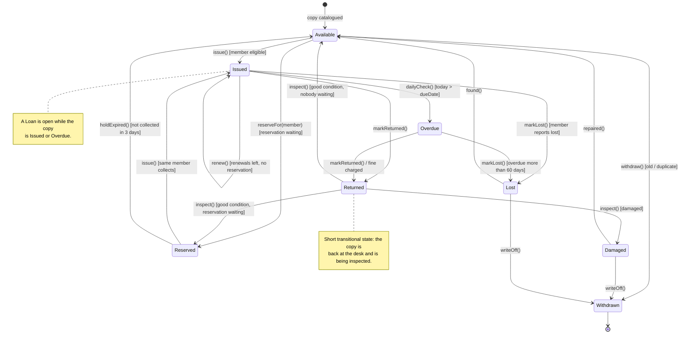
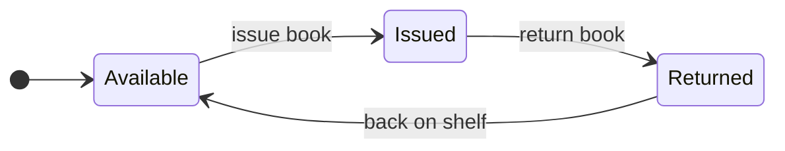

# 6. State Diagram: Book (physical copy)

[← Sequence Diagrams](05-sequence-diagrams.md) · [README](../README.md) · Next: [Data Model →](07-data-model.md)

The **status belongs to each physical copy** (`BookCopy`), not to the title. A library may own five copies of *Clean Code*, and each can be in a different state. The diagram below is the lifecycle of one copy, which is what "the Book object" means on the shelf.

## 6.1 State diagram

## 6.2 States

| State | Meaning | Can be borrowed? |
|---|---|---|
| **Available** | On the shelf | ✅ by anyone eligible |
| **Reserved** | On the hold shelf for one specific member | ✅ only by that member |
| **Issued** | Out on loan, not yet due | ❌ |
| **Overdue** | Out on loan, past the due date | ❌ |
| **Returned** | Just handed back and waiting for inspection (transitional) | ❌ |
| **Damaged** | Needs repair | ❌ |
| **Lost** | Reported lost or presumed lost | ❌ |
| **Withdrawn** | Removed from the collection (final state) | ❌ |

## 6.3 Transition table (events, guards, actions)

| From | Event | Guard [condition] | Action | To |
|---|---|---|---|---|
| Available | `issue()` | member eligible | create Loan, set due date | Issued |
| Available | `reserveFor(m)` | reservation waiting | set holdUntil = today + 3 | Reserved |
| Reserved | `issue()` | borrower = reserving member | fulfil reservation, create Loan | Issued |
| Reserved | `holdExpired()` | today > holdUntil | expire reservation, offer to next | Available |
| Issued | `renew()` | renewals left and no reservation waiting | dueDate += loanDays | Issued |
| Issued | `dailyCheck()` | today > dueDate | send overdue notice | Overdue |
| Issued / Overdue | `markReturned()` | open loan exists | close loan; fine if late | Returned |
| Returned | `inspect()` | good, no one waiting | none | Available |
| Returned | `inspect()` | good, reservation waiting | notify member | Reserved |
| Returned | `inspect()` | damaged | damage fine (optional) | Damaged |
| Issued / Overdue | `markLost()` | reported, or > 60 days overdue | charge replacement fine | Lost |
| Damaged / Lost | `repaired()` / `found()` | none | none | Available |
| Damaged / Lost / Available | `writeOff()` / `withdraw()` | none | remove from catalogue count | Withdrawn |

**Any event not in this table is illegal.** For example, `issue()` on an `Issued` copy is refused. In the [implementation](10-implementation.md), `BookStatus` stores the allowed next states and `BookCopy` throws an exception for an illegal transition.

## 6.4 The simple version from the brief

The brief's example, *Available → Issued → Returned*, is the "happy path" through the full diagram:

The full diagram in 6.1 adds what real libraries need: reservations, overdue loans, damage, loss and withdrawal.

More state diagrams (Loan, Member, Reservation) are in the [behavioral model](09-behavioral-model.md).
