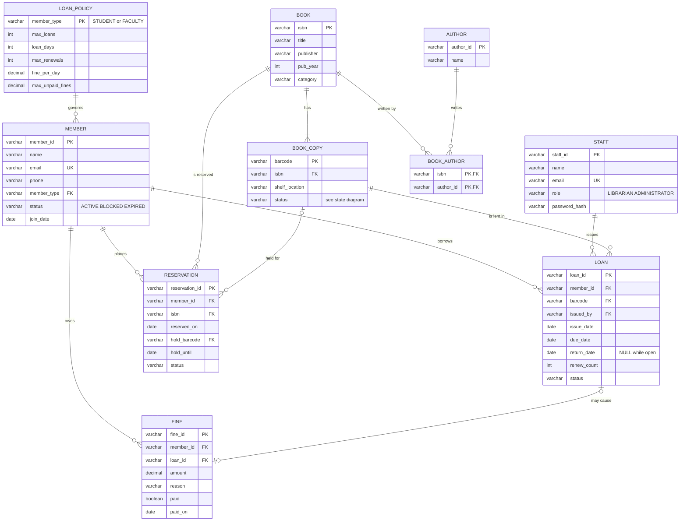

# 7. Data Model: how the data is structured

[← State Diagrams](06-state-diagrams.md) · [README](../README.md) · Next: [Functional Model →](08-functional-model.md)

The data model turns the [domain classes](03-class-diagram.md) into **persistent entities** (database tables). The full SQL is in [`sql/schema.sql`](../sql/schema.sql), and [`sql/sample-queries.sql`](../sql/sample-queries.sql) shows how it answers the use cases.

## 7.1 Entity-Relationship diagram

**Reading the crow's-foot notation:** `||` means exactly one, `o|` zero or one, `|{` one or more, and `o{` zero or more.
For example, `BOOK ||--|{ BOOK_COPY` means a book has **one or more** copies, and each copy belongs to **exactly one** book.

## 7.2 From classes to tables

| Class (OOA) | Table | Mapping decision |
|---|---|---|
| `Member` (extends `Person`) | `member` | Inheritance flattened: the `Person` fields are copied into each subclass table |
| `Librarian`, `Administrator` | `staff` | One table with a `role` column (single-table inheritance) |
| `Book` | `book` | Natural key: ISBN |
| `Author` | `author` + `book_author` | The many-to-many association becomes a **junction table** |
| `BookCopy` | `book_copy` | Composition: `ON DELETE CASCADE` from `book` |
| `BookStatus` enum | `book_copy.status` + `CHECK` | The enum becomes a constrained column |
| `Loan` | `loan` | Foreign keys to member, copy and staff |
| `Reservation` | `reservation` | Queue order = `reserved_on` (plus id) |
| `Fine` | `fine` | Optional link to `loan` (damage fines may have no loan) |
| `LoanPolicy` | `loan_policy` | One row per member type, editable by the admin |

## 7.3 Data dictionary (key tables)

### `book_copy`
| Column | Type | Constraints | Description |
|---|---|---|---|
| barcode | VARCHAR(20) | PK | Label on the physical copy |
| isbn | VARCHAR(17) | FK → book, NOT NULL | Which title this copy is |
| shelf_location | VARCHAR(20) | | e.g. `S1-A` |
| status | VARCHAR(10) | NOT NULL, CHECK in 8 states | Current state ([state diagram](06-state-diagrams.md)) |

### `loan`
| Column | Type | Constraints | Description |
|---|---|---|---|
| loan_id | VARCHAR(20) | PK | |
| member_id | VARCHAR(20) | FK → member | Borrower |
| barcode | VARCHAR(20) | FK → book_copy | Copy lent |
| issued_by | VARCHAR(20) | FK → staff | Librarian who issued it (audit trail) |
| issue_date | DATE | NOT NULL | |
| due_date | DATE | NOT NULL, ≥ issue_date | issue_date + policy.loan_days |
| return_date | DATE | NULL while open | |
| renew_count | INTEGER | default 0 | ≤ policy.max_renewals |
| status | VARCHAR(10) | ACTIVE / OVERDUE / RETURNED / LOST | |

### `member`
| Column | Type | Constraints | Description |
|---|---|---|---|
| member_id | VARCHAR(20) | PK | Printed on the library card |
| name | VARCHAR(100) | NOT NULL | |
| email | VARCHAR(120) | UNIQUE, NOT NULL | Used for notifications |
| member_type | VARCHAR(10) | FK → loan_policy | Decides the limits |
| status | VARCHAR(10) | ACTIVE / BLOCKED / EXPIRED | |
| join_date | DATE | NOT NULL | |

## 7.4 Business rules enforced by the database

| Rule | How it's enforced |
|---|---|
| A copy can't have two open loans | Partial unique index `one_open_loan_per_copy ON loan(barcode) WHERE return_date IS NULL` |
| A status must be valid | `CHECK (status IN (...))` |
| Due date can't be before issue date | `CHECK (due_date >= issue_date)` |
| No loan for an unknown member or copy | Foreign keys |
| Deleting a title deletes its copies | `ON DELETE CASCADE` (composition) |

These were tested by running the schema in SQLite: a second open loan on the same copy, an invalid status, an unknown member and a due date before the issue date are **all rejected**.

## 7.5 Normalisation

The schema is in **third normal form (3NF)**:
- **1NF:** no repeating groups. Authors live in `book_author`, not in an "authors" text column.
- **2NF:** in `book_author`, the only columns are the composite key itself.
- **3NF:** no transitive dependencies. A loan's due-date rules live in `loan_policy`, reached through `member.member_type`, and aren't copied onto each loan.
