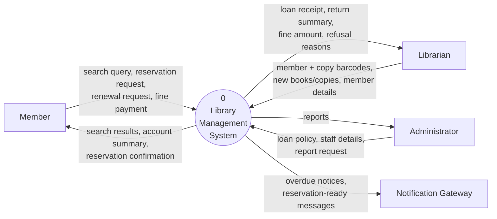
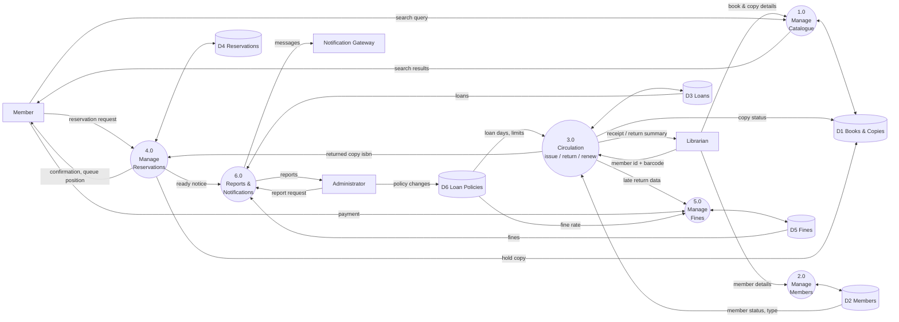
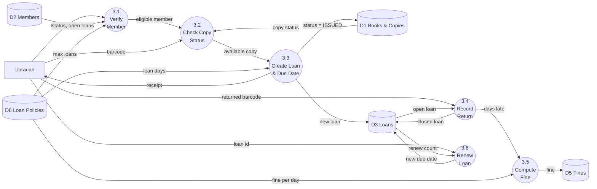

# 8. Functional Model: what the system does

[← Data Model](07-data-model.md) · [README](../README.md) · Next: [Behavioral Model →](09-behavioral-model.md)

The functional model describes the **functions (processes)** of the system and the **data that flows** between them, without saying *how* or *when*. It uses **Data Flow Diagrams (DFDs)**:

| Symbol in the diagrams | DFD element |
|---|---|
| Rectangle | **External entity** (outside the system) |
| Circle | **Process** (transforms data) |
| Cylinder | **Data store** |
| Labelled arrow | **Data flow** |

## 8.1 Context diagram (DFD level 0)

The whole system is one process. This shows only what goes in and out.

## 8.2 DFD level 1 (main processes)

Process 0 broken down into six processes, with the data stores from the [data model](07-data-model.md).

## 8.3 DFD level 2: process 3.0 Circulation

## 8.4 Functional decomposition

```mermaid
flowchart TB
    LMS["Library Management System"]
    LMS --> F1["Catalogue"]
    LMS --> F2["Membership"]
    LMS --> F3["Circulation"]
    LMS --> F4["Reservations"]
    LMS --> F5["Fines"]
    LMS --> F6["Administration"]

    F1 --> F11["Search books"]
    F1 --> F12["View details"]
    F1 --> F13["Add / edit book"]
    F1 --> F14["Add / withdraw copy"]

    F2 --> F21["Register member"]
    F2 --> F22["Update member"]
    F2 --> F23["Block / unblock"]
    F2 --> F24["View account"]

    F3 --> F31["Issue book"]
    F3 --> F32["Return book"]
    F3 --> F33["Renew loan"]
    F3 --> F34["Flag overdue loans"]

    F4 --> F41["Reserve title"]
    F4 --> F42["Cancel reservation"]
    F4 --> F43["Hold copy for next member"]
    F4 --> F44["Expire uncollected holds"]

    F5 --> F51["Calculate late fine"]
    F5 --> F52["Record payment"]
    F5 --> F53["Check unpaid total"]

    F6 --> F61["Manage staff"]
    F6 --> F62["Configure loan policy"]
    F6 --> F63["Generate reports"]
```

## 8.5 Key functions: inputs, processing, outputs

| Function | Input | Processing | Output |
|---|---|---|---|
| Issue book | member id, barcode | verify member → check copy → due date = today + loanDays → create loan → set copy ISSUED | loan receipt / refusal reason |
| Return book | barcode | find open loan → set return date → fine = max(0, days late) × rate → hand copy to next reservation or shelf | return summary, fine |
| Renew loan | loan id | renewals left? no reservation waiting? → due date += loanDays | new due date / refusal |
| Search | keyword, filters | match title/author/ISBN/category → count available copies | result list |
| Reserve | member id, ISBN | no copy available? not already reserved? → append to queue | queue position |
| Flag overdue | today's date | loans where returnDate is null and dueDate < today → status OVERDUE → notify | overdue count, notices |
| Calculate fine | loan, return date, policy | `daysLate = returnDate − dueDate`; `fine = daysLate × finePerDay` | amount |
