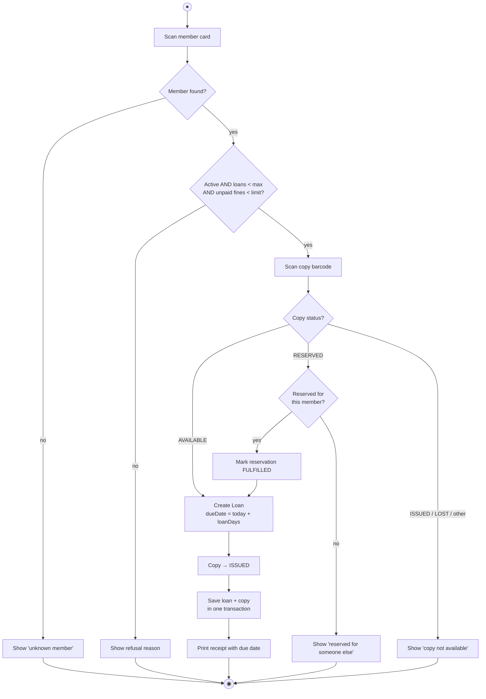
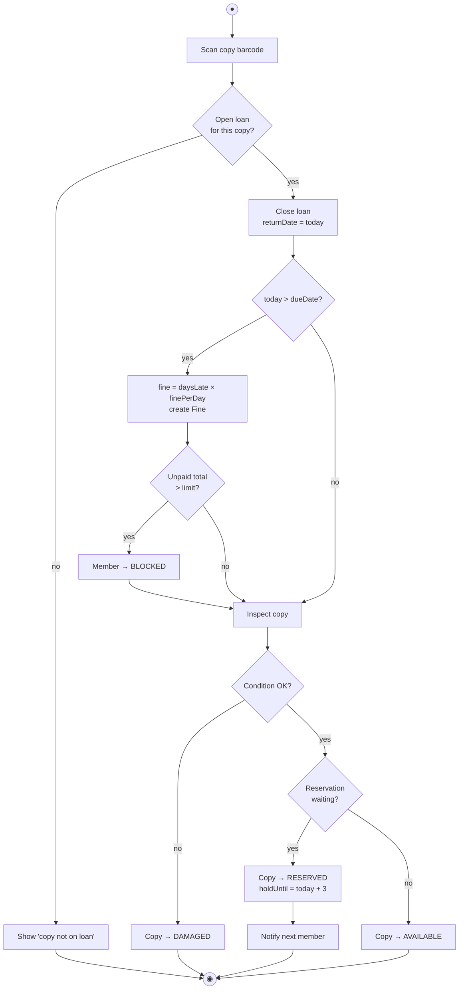
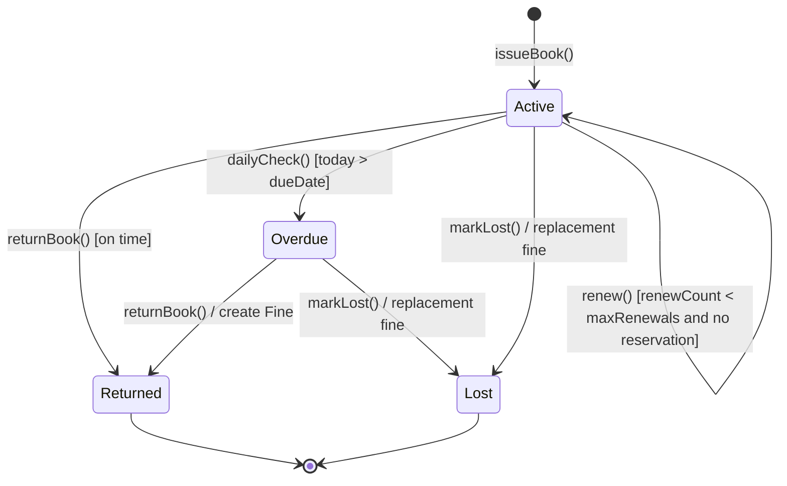
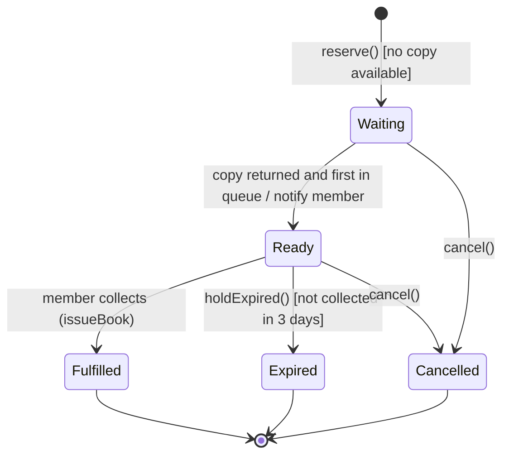
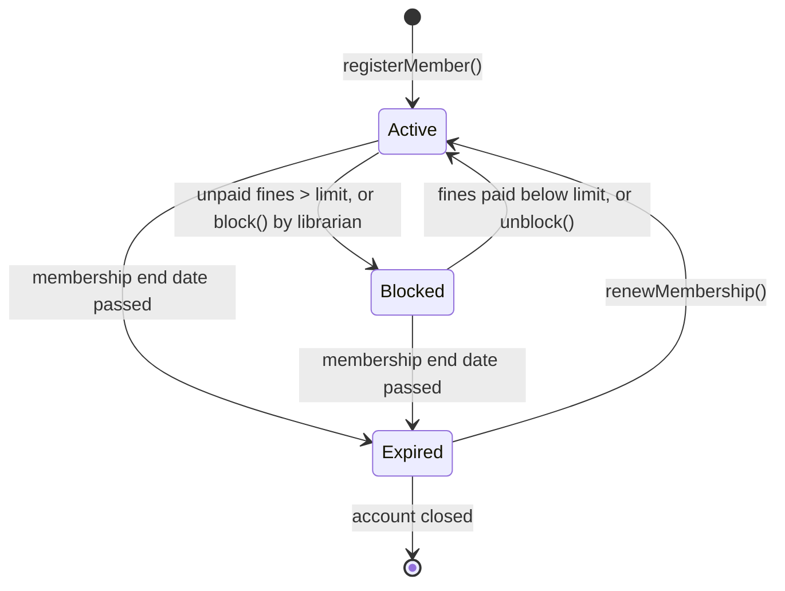
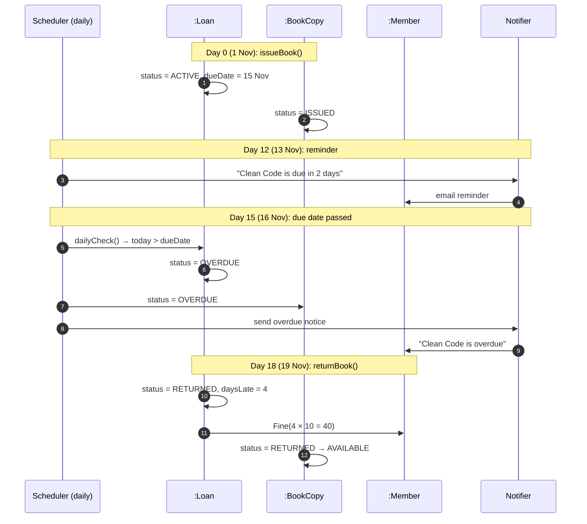

# 9. Behavioral Model: how the system behaves over time

[← Functional Model](08-functional-model.md) · [README](../README.md) · Next: [Implementation →](10-implementation.md)

The behavioral model shows **how objects and the system react to events over time**. It uses:

1. **Event-response table**: which event triggers which behaviour
2. **Activity diagrams**: the flow of steps and decisions in a process
3. **State diagrams**: the lifecycle of the objects that change over time (`BookCopy` is in [section 6](06-state-diagrams.md). This section covers `Loan`, `Reservation` and `Member`.)
4. **Timeline**: what happens to one loan day by day
5. **Sequence diagrams**: the interactions in time order are in [section 5](05-sequence-diagrams.md)

## 9.1 Event-response table

| Event | Source | System response | Objects whose state changes |
|---|---|---|---|
| Copy barcode scanned for issue | Librarian | Verify member, check copy, create loan | BookCopy → ISSUED, Loan → ACTIVE |
| Copy barcode scanned for return | Librarian | Close loan, compute fine, route copy | Loan → RETURNED, BookCopy → RETURNED → AVAILABLE/RESERVED, Fine created |
| Renew requested | Member / Librarian | Check renewals and queue, extend due date | Loan (dueDate, renewCount) |
| Reserve requested | Member | Queue the reservation | Reservation → WAITING |
| Midnight (daily tick) | Scheduler | Flag overdue loans, notify; expire old holds | Loan → OVERDUE, BookCopy → OVERDUE, Reservation → EXPIRED |
| Fine paid | Member / Librarian | Mark paid; unblock if under limit | Fine → PAID, Member → ACTIVE |
| Unpaid fines exceed limit | System (after a fine) | Block borrowing | Member → BLOCKED |
| Policy updated | Administrator | New values apply to **new** loans only | LoanPolicy |

## 9.2 Activity diagram: Issue Book

## 9.3 Activity diagram: Return Book

## 9.4 State diagram: Loan

## 9.5 State diagram: Reservation

## 9.6 State diagram: Member

## 9.7 Timeline: one student loan

